<a href="https://www.shakibmehrab.site"></a>

<a href="https://steller-tales.vercel.app/"></a>

<b><a href="https://steller-tales.vercel.app/">LIVE SITE ↗</a></b>&nbsp;&nbsp;&nbsp;<b><a href="https://github.com/Hackovate/steller-tales">SOURCE ↗</a></b>

<a href="https://momentum-gemini.vercel.app/"></a>

<b><a href="https://momentum-gemini.vercel.app/">LIVE SITE ↗</a></b>&nbsp;&nbsp;&nbsp;<b><a href="https://github.com/Hackovate/momentum">SOURCE ↗</a></b>

<a href="https://road-guardian-chi.vercel.app/"></a>

<b><a href="https://road-guardian-chi.vercel.app/">LIVE SITE ↗</a></b>&nbsp;&nbsp;&nbsp;<b><a href="https://github.com/shakib-mehrab/RoadGuardian">SOURCE ↗</a></b>

<a href="https://github.com/shakib-mehrab/ad-deen/releases"></a>

<b><a href="https://github.com/shakib-mehrab/ad-deen/releases">DOWNLOAD APK ↗</a></b>&nbsp;&nbsp;&nbsp;<b><a href="https://github.com/shakib-mehrab/ad-deen">SOURCE ↗</a></b>

<a href="https://pathik-db6ee.web.app/"></a>

<b><a href="https://pathik-db6ee.web.app/">LIVE SITE ↗</a></b>&nbsp;&nbsp;&nbsp;<b><a href="https://github.com/shakib-mehrab/pothik">SOURCE ↗</a></b>

<b>ALL PROJECTS (14)</b>

 

| Project | Area | Link |
|:--|:--|:--|
| Stellar Tales | Full-stack | [Live](https://steller-tales.vercel.app/) |
| Momentum | AI / Full-stack | [Live](https://momentum-gemini.vercel.app/) |
| RoadGuardian AI | AI / Full-stack | [Live](https://road-guardian-chi.vercel.app/) |
| Ad-Deen | Mobile | [Releases](https://github.com/shakib-mehrab/ad-deen/releases) |
| Pathik (পথিক) | Full-stack | [Live](https://pathik-db6ee.web.app/) |
| NovaMindXR | XR | [Demo](https://drive.google.com/file/d/1Cf4O8-2syDPnl7wWS69Iyp3mXly4Hyb5/view) |
| ASD Clinical Decision Support | AI / Healthcare | [Source](https://github.com/shakib-mehrab/ASD-system) |
| TuitionTrack | Full-stack | [Live](https://tutiontrack-tjdu.vercel.app/) |
| ZeroWaste | Full-stack | [Live](https://zero-waste-xi.vercel.app/) |
| CSE Society | Full-stack | [Source](https://github.com/shakib-mehrab/csesociety) |
| ChatDapp | Web3 | [Live](https://chatdapp-xi.vercel.app/) |
| FundChain | Web3 | [Source](https://github.com/shakib-mehrab/Fund-Chain) |
| MintZillo | Web3 | [Source](https://github.com/shakib-mehrab/mintZillo) |
| EtherPresso | Web3 | [Source](https://github.com/shakib-mehrab/etherPressoDapp) |


  
  
  

<picture>
  <source media="(prefers-color-scheme: dark)" srcset="https://raw.githubusercontent.com/shakib-mehrab/shakib-mehrab/output/pacman-contribution-graph-dark.svg">
  <source media="(prefers-color-scheme: light)" srcset="https://raw.githubusercontent.com/shakib-mehrab/shakib-mehrab/output/pacman-contribution-graph.svg">
  
</picture>

<a href="mailto:shakibmehrab@gmail.com"></a>

<b>
<a href="mailto:shakibmehrab@gmail.com">EMAIL ↗</a>&nbsp;&nbsp;&nbsp;
<a href="https://www.linkedin.com/in/mehrab-hossain-shakib-4b4293242/">LINKEDIN ↗</a>&nbsp;&nbsp;&nbsp;
<a href="https://x.com/mehrab_shakib">X / TWITTER ↗</a>&nbsp;&nbsp;&nbsp;
<a href="https://behance.net/4ba58887">BEHANCE ↗</a>&nbsp;&nbsp;&nbsp;
<a href="https://www.instagram.com/_mehrab.shakib_">INSTAGRAM ↗</a>&nbsp;&nbsp;&nbsp;
<a href="https://www.shakibmehrab.site">PORTFOLIO ↗</a>&nbsp;&nbsp;&nbsp;
<a href="https://www.shakibmehrab.site/resume.pdf">RESUME (PDF)</a>
</b>

<a href="https://www.shakibmehrab.site"></a>
